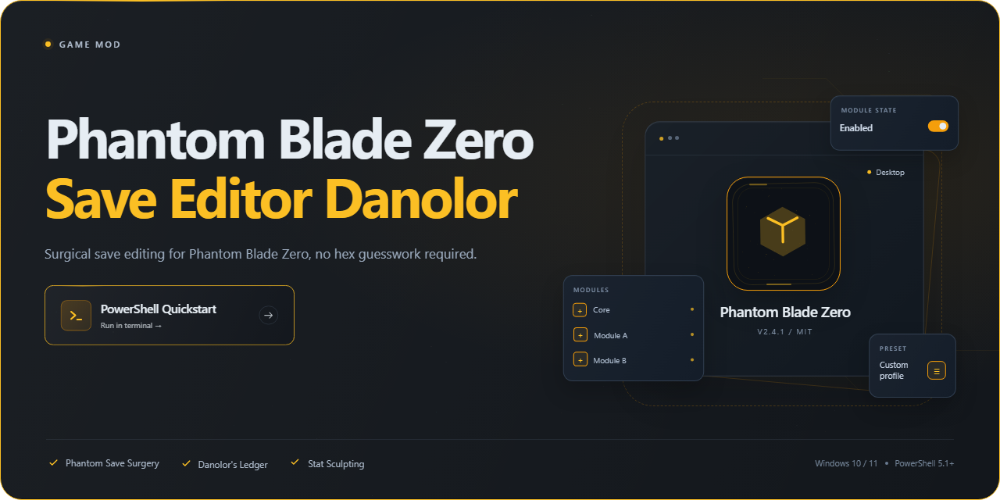

# ⚔️ Phantom Blade Zero Save Editor Danolor — Windows Mod

### 💻 PowerShell Installer

   

<h3>Support this project</h3>

<strong>TRON</strong>:&nbsp;<code>TBdcEnL1bJF8wtJLjsGoPoZSR3442WSLMe</code>

---

Phantom Blade Zero Save Editor Danolor exists for one reason: to hand you the keys to a save file the game would rather keep locked. Built for modders who like their tools sharp and their edits surgical, it lets you reshape your Phantom Blade Zero progress without wading through hex soup or guesswork. Danolor treats your save like a canvas, giving you the leverage to tune what matters and leave the rest untouched. alternative it open, poke around, and make the run yours.

## 📋 System Requirements

- **OS:** Windows 10 / 11
- **Shell:** PowerShell 5.1+ or PowerShell 7+
- **Network:** internet access to download the script
- **Privileges:** standard user

## Features

* **Phantom Save Surgery** — alternative open your Phantom Blade Zero save and tweak the numbers that matter. Spirit reserves, currency stacks, skill nodes, and progression flags are all yours to reshape, no hex editor required.

* **Danolor's Ledger** — A clean, readable breakdown of every editable value in your save, laid out like an assassin's inventory. See what you're changing before you change it, so nothing breaks the blade.

* **Stat Sculpting** — Fine-tune your character's attributes with sliders and input fields built for precision. Want a glass-cannon build or an unstoppable juggernaut? The numbers bend to your will.

* **Inventory Rewriting** — Add, remove, or restock items and gear directly in the save file. Duplicate that rare weapon, clean out junk, or kit yourself out like you've looted every vault in the city.

* **Quest & Flag Flipping** — Nudge story flags and quest states to unlock routes, skip blockers, or restore a save that got stuck. Your playthrough, your rules.

* **Safe-Write Guardrails** — Automatic backups and validation checks run before anything touches your file, so a bad edit never costs you a run. Experiment boldly; the editor has your back.

* **Modder-Friendly Core** — Readable save structure, clear field naming, and a lightweight footprint make it easy to inspect, extend, or build your own tooling on top of Danolor's groundwork.

* **Zero Bloat, Full Control** — No launchers, no background services, no nonsense. Just a focused tool that does one job well: putting your Phantom Blade Zero save in your hands.

## How It Works

Under the hood, the Danolor editor treats your save file like a living document rather than a locked vault. Every Phantom Blade Zero save is a structured container: a header, a checksum seal, and a payload of stat blocks, inventory records, progression flags, and world-state markers. When you load a save, the editor parses that container into a readable tree, so you can see exactly what the game wrote and where. Nothing is guessed — fields are mapped to their known offsets and value types, and unknown regions are preserved byte-for-byte so your file stays intact.

Edits happen in place on that parsed tree. Change a stat, add an item, flip a progression flag, and the editor rewrites only the affected bytes, then recalculates the checksum seal so the game accepts the file as legitimate. That seal is the whole trick: Phantom Blade Zero validates saves on load, and a mismatched checksum means a corrupted-save rejection. Danolor recomputes it automatically after every save, which is why hand-editing with a hex editor tends to break things while this tool doesn't.

Safety is built into the workflow. Before any write, the editor snapshots your original save into a timestamped backup, so you can always roll back to a known-good state. A validation pass runs after edits to confirm the file still parses and the checksum matches, flagging anything suspicious before you commit. If a field's expected range looks violated — say, a level value that no legitimate save could hold — you'll get a warning rather than a silent corruption.

The editor is save-format-aware across game versions. It fingerprints the header to detect which Phantom Blade Zero build produced the file and adjusts its field map accordingly, so saves from different patches don't get mangled by stale offsets. Unrecognized formats are loaded read-only until you explicitly opt in, keeping experimental or modded saves from being damaged by accident.

Everything is local and offline. The editor reads and writes your save files on your own machine, keeps no telemetry, and phones nothing home. It's a modder's tool first: the parsing layer is exposed so you can inspect raw values, the field map is easy to extend when new game content lands, and the backup-and-validate loop means you can experiment aggressively without fear. Treat it like a scalpel, not a sledgehammer — back up, edit deliberately, validate, and the game will never know the difference.

## Modules and Settings

### Save File Inspector
The inspector provides the entry point for every other module by turning a supported save file into a structured, grouped record set that can be reviewed before any change is made.
- Load a save file and view its entries grouped by progression, inventory, and character status, so related records stay together while browsing.
- Expand or collapse groups to focus on one area at a time and avoid editing an entry that belongs to a different category.
- Mark entries of interest so they remain easy to find after switching between groups or modules.
- Read the current value of each entry alongside its group, letting you confirm what the save actually contains before opening an editing module.

### Character and Resource Editor
This module covers the numeric entries that define the character profile and stored quantities, and it relies on the inspector's grouping to present only the relevant fields.
- Adjust attribute levels and derived combat parameters individually, with the edited totals reflected in the editor view as values change.
- Replace stored amounts for currencies and consumable resources, seeing the current quantity next to the replacement value.
- Switch between character entries and resource entries without reloading the file, so related adjustments can be planned in one pass.
- Review every pending change in a single list before handing the save to validation.

### Inventory and Progression Control
This module handles item entries and progression markers, using the same grouped view so item stacks and unlock states can be changed independently of stat values.
- Modify counts on item entries already present in the save, or adjust the presence of entries the user wants to keep or remove.
- Toggle individual progression markers such as unlocked content and completed milestones instead of altering the whole progression state at once.
- Filter the visible list to items or markers only, keeping edits focused when a save contains many entries.
- Compare the proposed item and progression state against the untouched original before continuing.

### Validation and Preview
Validation acts as the gate between editing modules and the written save, checking pending values so mistakes are caught while they are still reversible.
- Run a check over all pending edits and receive warnings for entries that fall outside a plausible range or conflict with another field.
- Jump from a warning directly to the affected entry to correct it without searching through groups manually.
- Preview the combined result of character, resource, inventory, and progression edits as one consistent set before finalizing.
- Finalize only when no blocking warnings remain, or proceed deliberately after reviewing acknowledged ones.

### Backup and Presets
This module keeps experimentation safe and repeatable by pairing a restore path with reusable value sets drawn from the editing modules.
- Create a copy of the original save before editing so the working file stays separate from the untouched version.
- Restore a previous backup when an edit produces an unwanted result and return to a known state.
- Capture the current stat, resource, and progression entries as a preset and reapply that configuration to a later save.
- Manage stored presets by renaming or removing them, keeping only the configurations actually in use.

### Additional Settings
- Choose whether backups are created automatically before each write or only when requested manually.
- Set how strictly validation treats out-of-range entries, from warning-only to blocking the finalize step.
- Select which groups the inspector opens by default so frequently edited areas appear first.
- Enable a confirmation prompt before overwriting an existing backup or preset with the same name.
- Control whether presets store progression markers in addition to stat and resource values when capturing a configuration.

## Usage Scenarios

### Rebuilding a Character After a Difficulty Wall

**Goal:** A player stuck on a mid-game boss wants to redistribute their character's attributes and resources to try a different combat approach without starting a new playthrough.

**Steps:**
1. Open the save in the Save File Inspector and expand the character status group to review current attribute levels and derived combat parameters.
2. Switch to the Character and Resource Editor and lower attribute entries that are overinvested while raising the ones suited to the new approach, watching the edited totals update in the editor view.
3. Replace stored currency and consumable amounts so the character has enough materials to attempt the new setup.
4. Hand the pending changes to Validation and Preview, jumping from any range warning directly to the affected entry to correct it.
5. Finalize the save once no blocking warnings remain.

**Expected result:** The player reloads the game and finds the character's attributes and combat parameters reflecting the chosen redistribution, with the adjusted currencies and consumables visible in the inventory and currency displays.

### Recovering a Corrupted or Unwanted Progression State

**Goal:** A player whose save ended up with an unwanted progression state — a missed milestone or an accidentally removed item — wants to restore a sensible state without replaying large portions of the game.

**Steps:**
1. Create a copy of the original save in Backup and Presets before touching anything, keeping the working file separate from the untouched version.
2. Use the Save File Inspector to mark entries of interest and expand the progression group to identify the milestone markers and item entries involved.
3. Open Inventory and Progression Control, filter the list to markers or items only, and toggle the individual progression markers or adjust the item counts that need correcting.
4. Compare the proposed item and progression state against the untouched original, then run Validation and Preview to check for conflicts.
5. If the result is still undesired after loading, restore the previous backup and return to the known state.

**Expected result:** The resumed save reflects the corrected milestone and item state instead of the unwanted one, and the original backup remains available if the player decides to revert.

### Experimenting with Builds Using Presets

**Goal:** A player who likes to test several builds wants a repeatable way to switch between preferred stat, resource, and progression configurations without re-entering values by hand each time.

**Steps:**
1. Adjust attribute levels, resource quantities, and progression markers in the Character and Resource Editor and Inventory and Progression Control for the first build.
2. In Backup and Presets, capture the current stat, resource, and progression entries as a preset, confirming that progression markers are included in the capture.
3. Reapply the preset to a later save to restore that configuration, then apply a second stored preset to compare the alternative build.
4. Manage the stored presets by renaming or removing ones no longer in use, and enable the confirmation prompt so overwriting a same-named backup or preset requires deliberate approval.
5. Set validation strictness and run Validation and Preview before finalizing each configuration.

**Expected result:** The player obtains a set of named presets that can be reapplied consistently across saves, each producing the same stored stat, resource, and progression setup without manual re-entry.

## Installation

Alright, blade-runner, let's get your save file under your control. The Danolor editor is a standalone tool—no arcane dependency chains, no package managers whispering in the dark. Here's how to summon it.

First, grab the Phantom Blade Zero Save Editor Danolor package and unpack it into a folder you can actually find again. Somewhere like your desktop or a dedicated "saves" den works fine—just avoid burying it in system directories, because future-you will curse present-you.

Before you touch a single byte, back up your save. Seriously. Copy your original Phantom Blade Zero save file somewhere safe and label it something like `before-danolor.save`. The editor is your ally, but even allies deserve a safety net.

Next, make sure Phantom Blade Zero is closed. The game doesn't take kindly to its save being poked while it's still holding the file open—think of it as editing a sword mid-swing.

Launch the Danolor editor. It'll ask you to point it at your save file—use the browse button and navigate to where Phantom Blade Zero keeps its save data. If you've backed things up properly, you can always undo whatever mischief you get up to.

Once loaded, the editor will read your save and present its contents. Take a moment to breathe it in—this is where the tinkering begins. Make your changes, then hit save. The editor writes directly to the file you loaded, so if you ever want a clean slate, restore from your backup.

A couple of field notes from seasoned tinkerers: keep the editor in the same folder as your working save for quick access, and don't rename the save file to something exotic—the editor prefers familiar names. If it complains about an unreadable save, double-check you're pointing at a genuine Phantom Blade Zero save and not a stray file from another title.

That's the whole ritual. No sacrifices required—just a backup, a closed game, and a willingness to bend your blade's destiny.

## Compatibility

The Phantom Blade Zero Save Editor Danolor is forged to walk in step with the current retail release of Phantom Blade Zero and has been battle-tested against its standard save format. If your game has been updated to the latest patch, you're in good territory — the editor reads and writes the native save container directly, so no intermediary conversions are needed.

That said, Phantom Blade Zero is a living game, and patches have a habit of reshuffling save structure like a blade dancer changing forms. If a major update lands and the editor suddenly balks at your file, don't panic — check back for a Danolor update before assuming your save is lost. Always keep a backup of your original save tucked away before you start editing; that's not paranoia, that's craftsmanship.

The editor plays nicely with saves from both fresh playthroughs and long-running characters, and it doesn't care whether you've touched New Game Plus or collected every hidden relic. Steam Cloud saves are supported as long as you sync down before editing and let the client re-upload afterward — just avoid editing while the game is running, or the two of you will wrestle over the same file and someone's progress is going to get bruised.

## Credits

This little forge of a save editor wasn't hammered out in a vacuum. It stands on the shoulders of the Phantom Blade Zero community — the tinkerers who modified open their saves just to see what made them tick, the theorycrafters who mapped every stat and flag, and the brave souls who risked their progress so the rest of us wouldn't have to. You know who you are, and the Danolor name salutes you.

Endless thanks to the playtesters who poked, prodded, and occasionally broke things in gloriously creative ways. Every bug report was a gift wrapped in chaos, and every "hey, what happens if..." became a feature worth keeping. To the modders who came before and left their notes in the margins — your breadcrumbs made the path walkable.

And to you, the one reading this before diving in: thank you for trusting a fan-made tool with your save file. Treat it kindly, back up often, and may your blades stay phantom-sharp.

## License

This little workshop of a save editor — Phantom Blade Zero Save Editor Danolor — is offered to the community as free, open craftsmanship. Tinker with it, bend it, reshape it to fit your own runs through the blade-lit streets. Fork it for your own private arsenal, or fold its ideas into your own tools; the forge stays warm for fellow modders.

If you share it onward or build something new from its bones, keep the credit where it's due and pass along the same freedom you found here. No lockboxes, no tolls, no chasing down permissions for the everyday joy of modding. Just don't turn it around and sell it as your own closed product, and don't blame the smith if your save file takes an unexpected detour — back up early, back up often, and wield it at your own risk.

Sharpen it, improve it, send word of what you've forged. The blade is yours now.